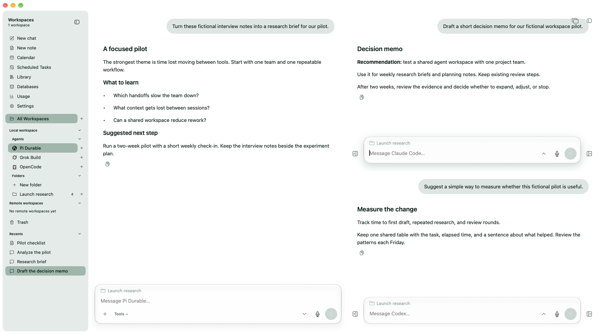
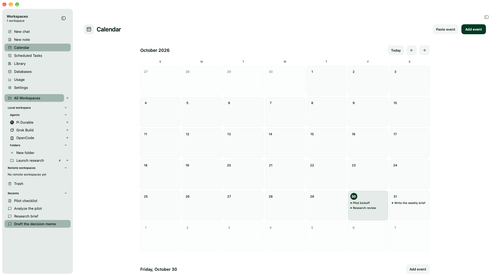

# Woven Matter

**One local Mac workspace for your AI agents.**

Run Pi Durable, Codex, Claude Code, Grok Build, and OpenCode side by side.
Keep your conversations, notes, and reference material together while choosing
the harness and model that fit each task.

[**Download for Mac**](https://wovenmatter.com/download) ·
[Getting started](docs/guide/getting-started.md) · [Documentation](docs/README.md) ·
[Website](https://wovenmatter.com)

**Apple silicon · macOS 26 or later · Free and MIT licensed**

No Woven Matter account required. Bring your own AI subscriptions or API keys;
provider charges still apply. **iOS is coming soon.**

*The desktop app with fictional demo conversations. Green theme, light appearance.*

## Your work, across agents

For people who already use AI agents for research, analysis, writing, and code,
Woven Matter puts those tools in a shared desktop workspace. Work in ordinary
project folders, compare answers in separate panels, and return to saved work
without keeping track of which vendor's app you used.

| Harness | Getting connected |
| --- | --- |
| **Pi Durable** | The included default agent. Connect providers and choose models and fallbacks in [Settings](docs/guide/default-agent.md). |
| **Codex** | Use your existing installation and account, or install from Settings. |
| **Claude Code** | Use your existing installation and account, or install from Settings. |
| **Grok Build** | Use your existing installation and account, or install from Settings. |
| **OpenCode** | Connect a supported OpenCode v2 installation, or install from Settings. |

Models, sign-in options, and session controls depend on the harness.
[Harnesses and accounts →](docs/guide/agents.md)

## What you can do

- **Work in parallel.** View up to five chat panels, with more sessions running in the background.
- **Keep a shared history.** Find conversations across harnesses and return to supported sessions.
- **Write beside your chat.** Create notes, spreadsheets, and HTML documents that agents can help edit.
- **Collect reference material.** Library keeps exchanged files, images, and links tied to their source conversations.
- **Work with data.** Managed databases feed live tables, values, spreadsheets, and HTML documents.
- **Schedule work.** Calendar and Scheduled Tasks organize events and recurring agent tasks.
- **Follow usage.** See recorded activity and the account limits your providers make available.
- **Set a goal.** Give an agent an explicit objective and track its progress in the conversation.
- **Browse in the workspace.** Use the embedded browser beside your work; control agent access with Browser Use.
- **Connect other tools.** Set up Executor, then give agents access to selected apps and accounts. It starts off.
- **Choose agent access.** Set tool defaults in Settings and adjust them for each conversation.

[Conversations and panels](docs/guide/conversations.md) ·
[Notes, Library, and Databases](docs/guide/notes-and-data.md) ·
[Calendar, Scheduled Tasks, and Usage](docs/guide/schedules-and-usage.md) ·
[Agent tools and permissions](docs/guide/agent-tools.md) · [Executor](docs/guide/executor.md)

| Notes beside your conversation | Calendar |
| --- | --- |
|  |  |

## Start on your Mac

1. [Download the latest DMG](https://wovenmatter.com/download) and move Woven Matter into Applications.
2. Connect a provider in **Settings → Pi Durable**, or set up another harness in **Settings → Local Workspace**.
3. Create a project folder or link an existing directory, then choose **New chat**.

Your history is stored locally. Project files stay in their workspace;
Woven Matter does not automatically synchronize local and remote folders.
[Getting started →](docs/guide/getting-started.md)

## Take work to a Linux host

Optionally run agents on your own amd64 or arm64 Linux machine over **Tailscale**,
with SSH key access, a non-root account, **Python 3**, and a **systemd user service**.
Agents use that account's permissions, without container isolation. Native remote
workspaces do not need Docker; the separate remote Executor option does.
Background work needs its host and service running.
[Set up a remote workspace →](docs/guide/remote-workspaces.md)

## Help and contribute

Read the [guides](docs/README.md), check [troubleshooting](docs/guide/troubleshooting.md),
[open an issue](https://github.com/wovenmatter/wovenmatter/issues), or email
[support@wovenmatter.com](mailto:support@wovenmatter.com).
For vulnerabilities, follow the [security policy](SECURITY.md).

Woven Matter is built under Trey's direction with an agent-driven workflow;
most commits come from the project's agent account.
See [Contributing](CONTRIBUTING.md) to build from source or help improve it.

[MIT license](LICENSE) · [Third-party notices](THIRD_PARTY_NOTICES.md) · [Trademarks](TRADEMARKS.md)
