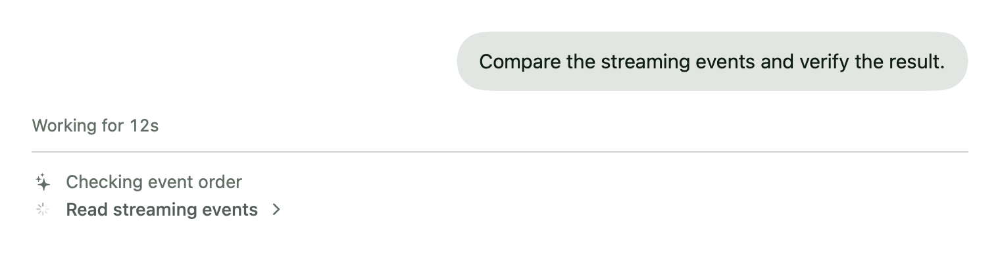
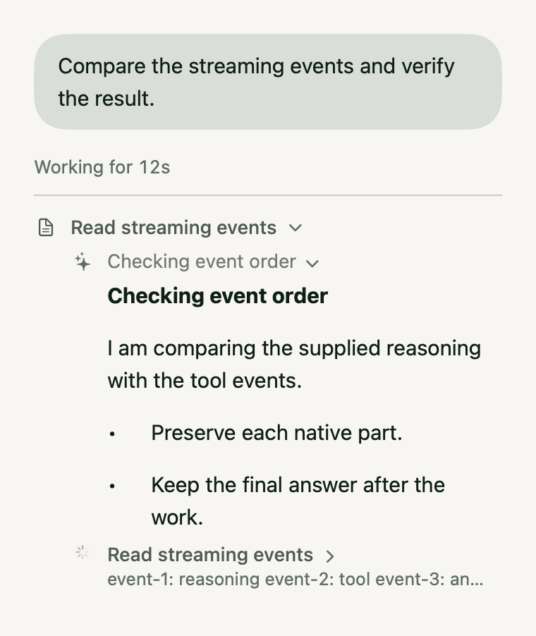
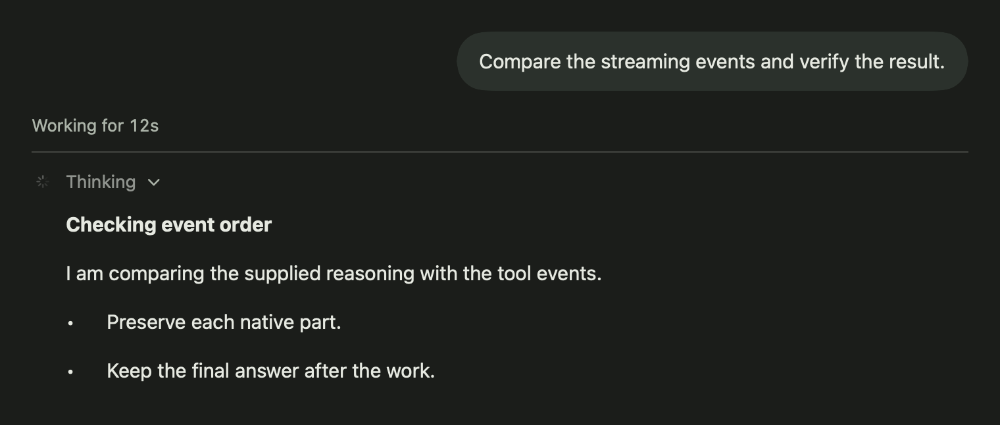

# Streaming verification

Streaming has three independently verifiable boundaries: provider/adapter wire,
Woven's event projection and persistence, and the rendered desktop/mobile transcript.
A passing wire probe does not establish a UI pass. A synthetic provider fixture
does not establish that an account or model is currently available.

## T3 comparison and upstream boundary

The source audit used `pingdotgg/t3code` at commit
[`68339a084644540f176ce83d97dd4c768b65b52e`](https://github.com/pingdotgg/t3code/tree/68339a084644540f176ce83d97dd4c768b65b52e).
The comparison is pinned to that source, rather than a claim about a later T3 release.

| T3 source finding | Woven implementation/verification consequence |
| --- | --- |
| [`CodexAdapterV2.ts`](https://github.com/pingdotgg/t3code/blob/68339a084644540f176ce83d97dd4c768b65b52e/apps/server/src/orchestration-v2/Adapters/CodexAdapterV2.ts) allocates reasoning identities from turn, item, summary/content stream and index, reserving order before delayed flushes; command output is incremental | Preserve native message identities and ordered work entries; append terminal output deltas rather than replacing preceding output |
| [`provider-opencode/v2/adapter.ts`](https://github.com/pingdotgg/t3code/blob/68339a084644540f176ce83d97dd4c768b65b52e/packages/provider-opencode/src/server/v2/adapter.ts) consumes `session.text.*`, `session.reasoning.*` and tool input/progress events, identifying blocks by assistant message, kind and ordinal | Subscribe to OpenCode's live `/api/event` stream in addition to durable history; maintain transient block projections and reconcile them with persisted snapshots |
| [`assistantStreaming.ts`](https://github.com/pingdotgg/t3code/blob/68339a084644540f176ce83d97dd4c768b65b52e/apps/server/src/orchestration-v2/assistantStreaming.ts) separates complete Markdown sections from an unfinished tail, respecting headings, lists and fenced code | Preserve stable rendered Markdown while showing the live tail; test partial fences, paragraph boundaries and terminal settlement |
| [`TimelineWorkGroupRows.tsx`](https://github.com/pingdotgg/t3code/blob/68339a084644540f176ce83d97dd4c768b65b52e/apps/web/src/components/chat/TimelineWorkGroupRows.tsx) filters hidden entries, opens reasoning-only groups directly as traces, and captures the pre-layout edge before appends | Shared visibility/grouping policy, direct formatted reasoning disclosures, and native acceptance tests that distinguish append following from status changes |
| [`presentation.ts`](https://github.com/pingdotgg/t3code/blob/68339a084644540f176ce83d97dd4c768b65b52e/packages/client-runtime/src/work-log/presentation.ts) supplies compact tool labels and a short live thought line | Show the supplied heading or sentence beside the active tool, with the complete exposed trace reachable in its disclosure |
| [`WorkLog.tsx`](https://github.com/pingdotgg/t3code/blob/68339a084644540f176ce83d97dd4c768b65b52e/apps/web/src/components/chat/WorkLog.tsx) keeps selectable details in a bounded scroll area and follows only within four pixels of its live edge | Bounded native work scrolling, reading-position preservation, and shared detail rendering in the app's existing themes |

There is a concrete Codex ACP upstream limit. Inspection of both installed Codex
ACP 2.2.2 and current stable 2.3.0 in `dist/index.js` found
`item/reasoning/summaryTextDelta` and
`item/reasoning/textDelta` routed to `createReasoningDeltaEvent`, which emits
`agent_thought_chunk` with `messageId = itemId` and the supplied delta. It drops
the original stream kind and `summaryIndex`/`contentIndex`. Woven preserves the
text and identity that ACP supplies, but cannot reconstruct that discarded
summary/content distinction. Full parity with T3's direct Codex stream identity
requires the adapter to retain those fields or a transport that exposes them.
No test or UI change here claims to recover information absent from the wire.

Claude ACP 0.97.0 identifies text and thinking chunks with the Anthropic API
message ID, using the same identity for live chunks and consolidated/replayed
messages (`messageIdForGrouping`, `applyMessageId`). Its `thinking_delta` path
forwards the exposed text but does not retain the content-block index in the ACP
chunk. Internally it tracks index/type to prevent consolidated-message duplication;
that internal index is not an additional public reasoning-block identity. The
installed 0.94.0 already has the same message-ID forwarding route. Neither latest
adapter adds the missing distinction described above, so an adapter upgrade alone
does not establish more detailed reasoning-block parity.

## Repeatable offline contract matrix

Run `node scripts/streaming-contracts.mjs --portable` for the JavaScript contracts,
`--native` for the Swift contracts, or `--all` for both. `--skip-build` reuses already
compiled Swift tests. `--output /absolute/report.json` writes suite results and
durations. The runner uses the same frozen Swift resolution and validation cache
conventions as `scripts/test-changes.sh`. Install the committed Node graph with
`npm ci --prefix default-agent --ignore-scripts --no-audit --no-fund` first.

The manifest names actual suites rather than treating source-code pattern matches
as behavioral tests. No contract suite consumes a provider service.

| Boundary | Suites | Contract |
| --- | --- | --- |
| Pi Durable native engine | `native-message-stream`, `native-tool-stream`, `durable-engine` | Ordered text/thinking blocks, pending tool arguments, running tool output, snapshot replacement/removal, Unicode, completion, partial provider failure, and cancellation |
| Claude native translation | `claude-native-session` | Synthetic Anthropic SSE translation and native continuation, including signed thinking and tool validation |
| iOS inference bridge | `ios-inference-stream` | Actual bridge retains partial text/thinking/usage on disconnect, cancellation and missing terminal; ignores duplicate terminal frames |
| Remote execution | `durable-acp`, `task-gateway`, `client-execution-publisher` | Recovery replay, assistant snapshots, lost receipts, immutable event deduplication, persistence failures, reconnect while approval is pending |
| Background streaming | `opencode-task-stream`, `task-gateway-native`, `client-execution`, `client-retained-history`, `reasoning-details` | Progress before idle, final-history reconciliation, ordered native tools, atomic snapshot framing, complete reasoning, coalescing and checkpoint recovery |
| Swift ACP adapters | `ACPHarnessStreamingReviewTests` | Actual client fed fixture processes; reasoning phases, assistant snapshots, boundaries, model/thinking selection and tool deltas |
| Swift OpenCode | `OpenCodeLiveProjectionTests`, `OpenCodeIntegrationTests`, `OpenCodeWireCaptureTests` | Live event reduction, message identity, durable refresh/recovery, HTTP/SSE recording without credentials |
| Transcript persistence/presentation | `ACPAssistantStreamWriterTests`, `AssistantStreamingTextTests`, `ConversationWorkTimelineTests`, `StreamingPresentationTests`, `CompanionPublisherTests` | Canonical prefixes, stable Markdown, commentary/tool order, native scrolling and verified full reasoning disclosure after restart |
| Cross-client reasoning details | `CompanionActivityDetailsTests`, `TranscriptDetailTests`, `CompanionFederationTests` | Shared v1/v2 reconstruction, scoped integrity, mobile duplicate-part recovery, pending chunks, restart and search isolation |

Browser and computer calls retain distinct action labels/icons, including current
`woven_browser_use`/`woven_computer_use` and legacy browser names. Browser actions
are not counted as fetched web pages in collapsed work summaries.

The Pi engine cases exercise the shared Durable event contract. They must not be
described as independent live OpenAI, Anthropic, Gemini or other family passes.
The native suite requires macOS; the manifest does not replace required iOS or
application build validation.

## Rendered acceptance scenes

`StreamingPresentationTests` renders the production shared SwiftUI transcript and
native Markdown views in Green, Cognac and Dark, at 380- and 760-point widths.
All 42 combinations of initial thinking, live tools, expanded mixed work, live
reasoning, detail-only reasoning, completion and interruption pass. Assertions
check the actual native text, including the final committed reasoning list item;
the export captures the same views for visual inspection.

```sh
WOVENMATTER_STREAMING_SCREENSHOTS=/private/tmp/woven-streaming-views node scripts/streaming-contracts.mjs --native
```

These captures establish rendered fixture behavior; they do not establish a live
provider-to-screen pass. Separate native acceptance tests mount the production
work disclosure in an owned window and move only its own `NSClipView`. They
verify following new tools at the live edge, retaining a reader's offset above
that edge across append/status changes, and restoring the offset after closing
and reopening the disclosure. Thought-only tests also verify paragraph growth
at and above the live edge and position retention after a longer replacement.
They do not send global scroll gestures.

Remote reasoning uses a versioned `wovenmatter.activity.v2` envelope over the
existing opaque native-record transport. Routine rows retain a bounded preview
and at most 16 KiB of inline JSON. Larger traces use verified 128 KiB chunks:
complete bases at geometric growth checkpoints, linked suffix records between
bases, and a final complete base on completion, failure, cancellation or close.
Updates coalesce at 400 ms. The producer appends incoming text to a crash-safe
accumulator and commits bounded metadata, avoiding full-file rewrites per token.
Derived v2 records do not create duplicate search hits; the source archive remains
searchable. Legacy v1 complete projections and mobile owner publication retain
their existing format.

Desktop and mobile disclosures resolve the chain on demand, validating scope,
identity, ordering, byte size and SHA-256. These resolvers ship together with the
new producer; older clients retain bounded previews until upgraded. Tests cover
large traces, advancing-time growth, Unicode, lost acknowledgments, restart,
corrections and clearing.
An explicit pointer with missing chunks remains pending and retries while its
disclosure is visible; its preview is never cached as the full settled trace.
Previously completed captures that never stored a detail pointer are not
retroactively repaired by this change.





The advancing-clock stress case supplies 400 updates and reconstructs every live
revision. A 1,638,400-byte Unicode trace transferred 5,459,254 native bytes, with a
1,650,000-byte accumulator and approximately 22 KiB of metadata. Exact preview-cap
surrogate pairs, a forced mid-run partial flush, extended-grapheme preview cuts
and identical multipart replay under new event IDs have targeted regressions.

## Platform validation boundary

The full default-agent and remote suites, Swift package suites, application usage
and backend lifetime checks, shared/mobile package tests, and 30 companion
integration tests passed. The native macOS application build, packaged HTML tools
for all five harnesses and browser lifecycle fixture also passed. The isolated
`streaming-parity` snapshot Dev app was built and launched for inspection. Its
active work is preserved; the final source uses a separate `streaming-parity-review`
snapshot instance.

The iOS app and test host compile, but simulator execution is not an acceptance
pass: the installed Xcode runtime repeatedly reported
`DTServiceHubClient failed to bless service hub`. The owned test run was stopped
and its disposable simulator cleaned up. No system approval or authentication
UI was operated to recover that environment. Consequently a single successful
end-to-end `scripts/test-changes.sh --all` run and the iPhone/iPad runtime matrix
are still outstanding, even though their independent source checks passed.

## Manual live probes

Live probes are intentionally excluded from tests and CI. They consume provider
services only when separately authorized and explicitly invoked with `--live`:

```sh
node scripts/live-streaming-smoke.mjs --live --harness codex --model gpt-6.1-sol --output /private/tmp/codex-stream.json
node scripts/live-streaming-smoke.mjs --live --harness grok_build --output /private/tmp/grok-stream.json
node scripts/live-opencode-streaming-smoke.mjs --live --model opencode/glm-5.3-flash-free --output /private/tmp/opencode-stream.json
```

The ACP runner uses Woven's installed managed adapters for Codex/Claude and the
installed Grok agent-stdio command. `--executable` can select an existing adapter;
`--catalog-only` creates a scratch session without sending a prompt. It negotiates
the same protocol version as Woven (v1 for Codex/Claude). Models must use the
advertised config-option identifier when available, rather than the legacy
model-plus-effort identifier. The runner denies client permission requests,
supplies no filesystem/terminal/MCP client capabilities, disables Grok web and
subagent tools, uses an isolated temporary working directory, and bounds execution.

The OpenCode runner uses the existing loopback service registration in memory,
creates a temporary native session in a scratch directory, selects an explicit
provider/model, applies a wildcard deny policy, listens to `/api/event`, and deletes
only its own temporary session afterward. It records event field names and types
to help compare the installed protocol to fixtures. It never prints registration
credentials, headers, provider response text, or raw errors. A cleanup failure is
reported. Neither runner initiates authentication or recovers expired accounts.

Reports contain elapsed milliseconds, first-event timings, chunk counts and terminal
status. They establish incremental wire delivery before terminal completion only;
they do not prove visible rendering, semantic correctness, tool execution,
reconnection, or absence of duplication. Those require the offline contracts and
separate application verification. Only provider-exposed reasoning is observable.

## Live evidence: 2026-10-27 UTC

These probes used existing sessions and scratch directories. No production SQLite
database was opened. Raw response content and credentials were not retained in
repository evidence.

The final portable contracts passed 31 Pi/native cases, 5 Claude translation
cases, 40 remote recovery cases, 51 background streaming/detail cases,
4 iOS inference bridge cases and 2 probe-script cases (133 total).
The initial sandbox run blocked local fixture listeners with
`listen EPERM`; repeating through the approved execution path passed. Those
fixture listeners do not consume provider services. Native Swift and rendered
application evidence is recorded separately in the platform validation above.

| Harness/model | Observed result | First reasoning | First text | Terminal |
| --- | --- | --- | --- | --- |
| Codex ACP 2.2.2 / `gpt-6.1-sol` | Passed incremental ACP wire check: 110 text chunks, 375 characters | Not exposed | 3,860 ms | `end_turn`, 6,616 ms |
| Codex ACP 2.3.0 / `gpt-6.1-sol` | Passed current stable adapter wire check: 80 thought chunks (401 characters), 116 text chunks (374 characters) | 11,353 ms | 13,017 ms | `end_turn`, 13,340 ms |
| Grok / advertised default | Passed incremental ACP wire check: 11 thought chunks (243 characters), 105 text chunks (498 characters) | 2,549 ms | 13,818 ms | `end_turn`, 14,498 ms |
| OpenCode / `opencode/glm-5.3-flash-free` | Execution failed before any text | None | None | `session.execution.failed` |
| OpenCode / `opencode/deepseek-v4.1-flash-free` | Execution failed before any text; native error classified as authentication | None | None | `session.execution.failed` |
| OpenCode Go / `opencode-go/glm-5.3-flash` | Advertised as enabled/active; execution failed before any text with an authentication-category native error | None | None | `session.execution.failed`, 431 ms |
| OpenCode Go / `opencode-go/gpt-6-luna` | Advertised as enabled/active; execution failed before any text with an authentication-category native error | None | None | `session.execution.failed`, 278 ms |
| Claude ACP 0.94.0 / advertised default | Passed incremental ACP wire check after the user restored sign-in: 37 text chunks, 393 characters | Not exposed | 2,002 ms | `end_turn`, 3,956 ms |
| Claude ACP 0.97.0 / advertised default | Passed current stable adapter wire check: 34 text chunks, 394 characters | Not exposed | 2,487 ms | `end_turn`, 4,199 ms |
| Pi Durable live provider families | Temporary native-client probe initialized successfully, but the normal account API returned no connected providers or configured models for its global/local scopes; live inference blocked | Not run | Not run | Not run |
| Pi Durable / signed review snapshot | Normal disposable-session initialization succeeded; metadata was available, but model options and thinking levels were empty and no model was selected. No prompt was sent | Not run | Not run | Not run |

Installed command versions observed: Codex CLI 0.164.0, Claude Code 2.1.310,
Grok 1.0.67, OpenCode CLI 2.1.2. The already-running OpenCode service registration
reported 2.1.3, so the service schema—not the CLI version—owns those HTTP/SSE probes.
Its public `/openapi.json` was inspected to check native event field contracts.

The initially installed managed adapters were Codex ACP 2.2.2 and Claude ACP
0.94.0, independently of their CLI versions. Official npm registry metadata then
confirmed current stable adapter releases 2.3.0 and 0.97.0. Those exact packages
were installed with lifecycle scripts disabled in an isolated temporary directory
and probed at 02:47–02:48 UTC through existing authenticated sessions. The managed
Woven installations were unchanged. The current repository catalog already has
minimum adapter versions 2.3.0/0.97.0; verification required no additional dependency
or floor update. Timing differences between these individual requests are not an
adapter performance comparison.

The Go rows were probed separately at 02:36 UTC against the existing native
service, using the advertised `opencode-go` routing and two model families.
The model catalog marked both enabled and active, but that metadata did not
establish usable provider authentication. Both sessions failed before text and
were deleted after the probes. These results supplement, rather than infer from,
the earlier free-provider failures.

Claude's initial status check returned exit 1 and `loggedIn: false`, including an
approved retry outside the sandbox. The user subsequently restored sign-in; the
01:18 UTC live probe succeeded and supersedes that blocker. The agent performed
no authentication recovery.

The Pi probe was a temporary manual Swift executable linked against the compiled
WovenMatterClient/Core/Companion modules. It started the actual `LocalACPClient`
and repository Pi runtime in a disposable directory. Its account coordinator used
`DefaultAgentSupport.snapshot(workspace:)` with silent Keychain access and with
credential renewal explicitly disabled; no payloads or credential values were
logged or written. Adding the existing `wovenmatter.desktop` public preferences
suite to its in-memory search path did not change the result: both global/local
scopes returned no configured models or connected provider identifiers, and the
session exposed no model options. This establishes an unavailable connection for
that standard namespace, not that another installed application instance lacks
credentials. No model request was submitted and no application database was opened.

The signed `streaming-parity-review` snapshot was also checked through its normal
same-user backend API. It reported ready, with no displayed accounts/providers,
models, default model, local override or custom servers. A disposable Pi chat
then initialized through the ordinary application path and still advertised
`modelOptions=[]`, `thinkingLevels=[]`, `model=null`, without a setup error.
No prompt was sent. This checks the actual app context as well as the temporary
client, without explicit login, reconnect or account-refresh operations. The
production app's expected control socket was absent; its configured accounts
therefore remain unknown through this route. Production SQLite and credentials
were not accessed to infer a connection.

The initial Codex attempt used a legacy `gpt-6.1-sol[low]` selection against the
config-option API and was rejected with JSON-RPC -32602 before inference. Selecting
the advertised `gpt-6.1-sol` configuration value produced the successful row above.
There is no claimed live OpenCode text, Pi family, UI, reconnect, error/abort,
or tool-output pass from these five successful wire probes.
