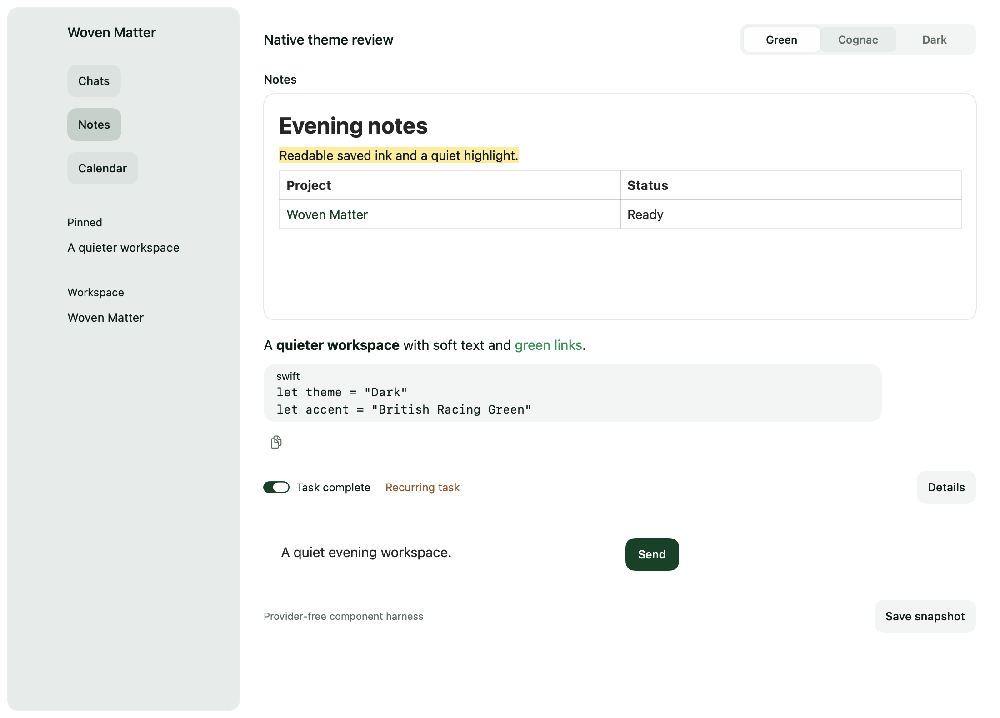
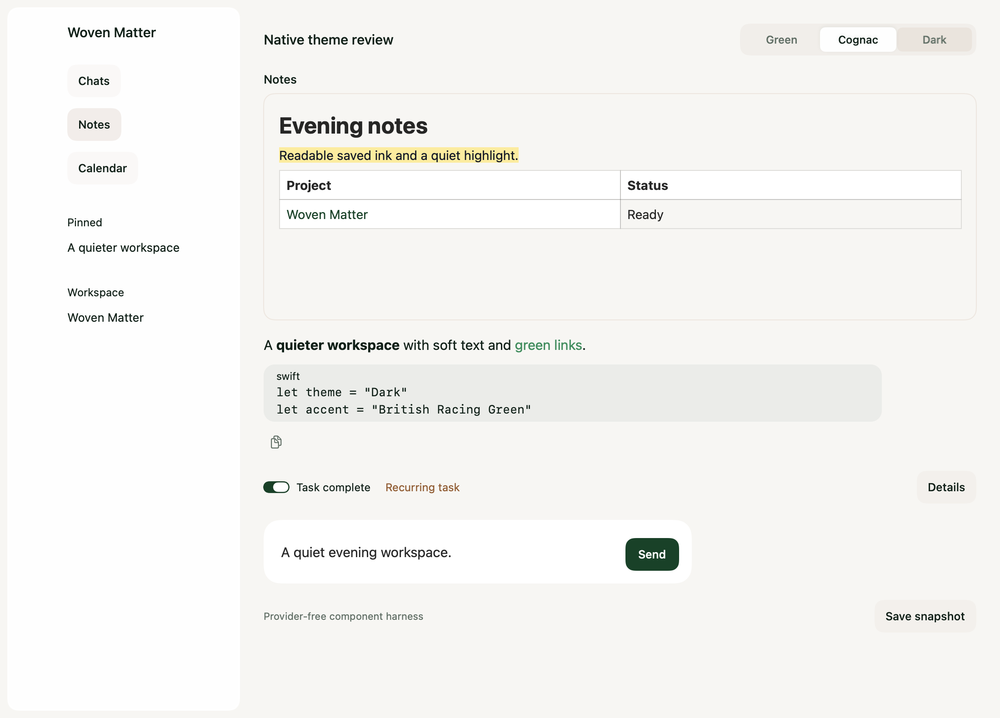
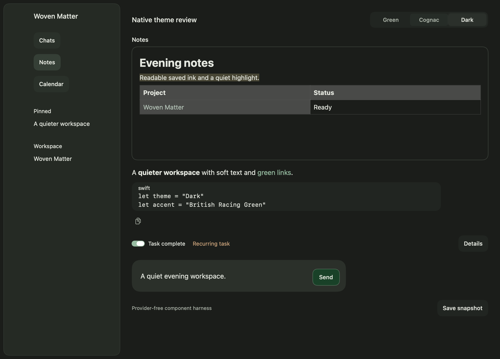

# Dark theme component comparisons

These captures use production theme, shared-control, Notes, conversation-response,
and composer components in a provider-free native view harness. They show the
existing Green and Cognac palettes alongside Dark. Full-app visual acceptance
remains part of PR review.

| Green | Cognac | Dark |
| --- | --- | --- |
|  |  |  |
