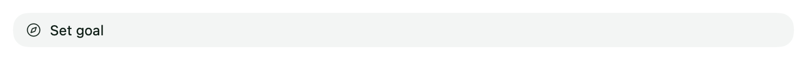
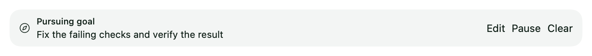

# Agent setup

WovenMatter has dedicated integrations for Codex, Claude Code, Grok Build,
Cursor, Hermes, OpenClaw, OpenCode, and Pi. Use your existing installations or
install harnesses in the settings page. Use your existing provider accounts
and/or API keys; models, authentication, and controls depend on the harness.

A **harness** is the software that runs the agent. Settings also calls it a
**runtime**. A **provider** supplies the model and account access.

## Set up a harness

1. Open **Settings → Local agent workspace**, or select a workspace under
   **Remote agent workspaces**.
2. Find the harness under **Runtimes**. If it is missing, select **Install**
   and review the installer before confirming.
3. Enable the harness and complete its sign-in or connection setup.
4. Choose **New chat** and select the agent in that workspace.

Start with a harness you already use and have provider access for. WovenMatter
can discover supported installations and account access. Installation, enabling,
and authentication are separate steps; completing one does not complete the others.
A remote workspace has its own installations and credentials.

## Harness settings

Open the harness's **Settings** for its connection and maintenance controls.
Hermes and OpenClaw include agent and service settings. OpenCode includes model
selection and server controls; configure its provider accounts through OpenCode.

OpenCode uses a specific supported v2 build. Use the app's installation flow to
get the compatible version. Stopping a shared service can affect other clients
using that service.

## Updates and visibility

Use **Check for updates** or **Update** in the runtime row. A check reports
available updates without installing them. Finish active work before updating;
a busy runtime may block maintenance. Remote updates apply to the selected workspace.

**Hide** controls sidebar visibility. **Disable** turns off the integration
without uninstalling the software or deleting its data. For OpenCode, disabling
disconnects WovenMatter while leaving the shared server running; use **Stop server**
to stop it.

For adapter details, component versions, and update behavior, see
[Runtime installation and updates](../RUNTIME_MAINTENANCE.md).

## Goals

Goals keep a chat working toward an outcome across turns. They are available for
Pi Durable, Codex, Claude Code, Grok Build and OpenCode, locally and in remote workspaces.

Tell the agent to set a goal, choose **Set goal** above the composer, or send
`/goal` followed by the outcome and how to verify it. Each chat has one goal.
The goal row shows the objective, status and reported token usage. Use **Edit**
to change the objective or set an optional token or turn budget. Editing pauses
the goal; **Resume** starts work again.

Use `/goal` to show the current goal, `/goal pause`, `/goal resume`, or
`/goal clear`. **Stop** pauses the goal before stopping the current run. Goals
also pause when the execution service restarts or Goals tools are disabled.
They require an explicit resume after either event.

The agent marks a goal achieved only after verifying it. A stalled goal retains
its explanation so you can resolve the blocker and resume. Budgets are checked
between turns; reaching a budget does not mark the goal achieved. If token usage
is unavailable, a token budget prevents further continuation. A turn budget is
available when you want to limit iterations instead.

Normal messages retain their priority. A goal waits for active work, questions,
approvals and queued inputs before beginning another turn. Plan mode does not
start automatic goal work.

The controls before setting a goal and while pursuing one:

These examples use the native component with isolated sample data.
