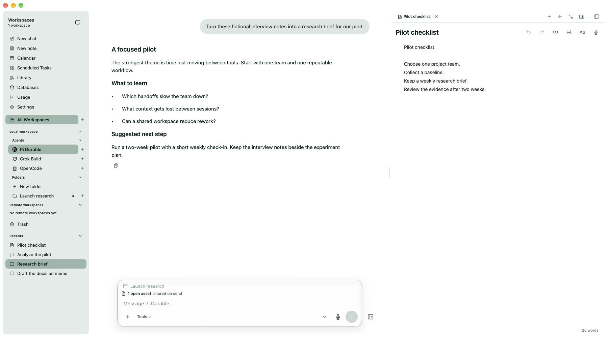

# Notes and data

Open a note beside your conversation to work on it with your agent. Keep a
research summary in view, develop a plan, or organize reference material without
scrolling back through the chat. Notes and conversations can share the same folders.

## Library

**Library** collects files, links, and photos, including screenshots, exchanged
in new messages after the feature becomes available. Existing conversation
history is not added. An item appears when you send an attachment or link, or
when an agent hands back a file, image, link, or citation. Files only mentioned
in internal tool activity are not collected. Notes and conversation references
remain message attachments and do not appear as Library files.

Combine workspace, agent type, individual agent, sender, and item-type filters.
Workspace and agent filters allow multiple selections, all, or none. Date
filters include Today, Last 7 days, Last 30 days, Last 90 days, and All time.
Search by title, link, or conversation, and sort newest or oldest first. Each
item shows its sender, workspace, and sent date and time.

Choose **Open** to open the link, photo, or file, or **Show in conversation** to
jump to its source message. Archived conversations show a read-only source
message. Separate exchanges have separate entries, even when they share a URL
or file. Deleting a source message, clearing its conversation, or deleting the
conversation removes its Library entries. Archiving keeps them.

Web URLs stay links. Uploaded files reuse existing attachment storage. Files
handed back from a local workspace or a connected remote workspace are saved
as local snapshots, up to 25 MB each, so they remain available after the
workspace disconnects or the original changes. Remote reads use the existing
workspace connection and are restricted to its working folder and temporary
output folders. Unavailable files show the reason and a **Retry** action;
reconnect the workspace or ask the agent for a smaller file when needed.

File bytes live on disk, outside SQLite. Identical saved content shares one
stored copy; unreferenced Library copies are cleaned up after a short grace
period. Original workspace files are not deleted or edited by the Library.

## Work beside a note

The **New Note** picker offers **Note**, **Spreadsheet**, and **HTML**. Each is
saved in Woven Matter's SQLite database. You can take and organize notes without
connecting an agent.

Keep up to four assets open in the shared tab strip. Tabs stay open when you
switch conversations. Closing a note tab keeps the saved note; hiding the asset
pane keeps its tabs. Open tabs are not restored after quitting the app.

With **Notes** enabled in the conversation's **Tools** menu, the agent can find,
read, create, and edit workspace notes. Opening a note beside the conversation
shares open-note references when you send a message, with the selected tab marked
active. Ask the agent to add text, update a table, or create an HTML artifact;
changes appear in the editor. Disable Notes to stop further tool access. See
[Agent tools](agent-tools.md) for every tool group.

## Browse beside your work

Use the globe beside the chat to open the browser. Notes and browser pages share
the asset pane; the tab-strip plus opens another browser tab, up to eight. Enter
an address or search in the URL bar. The ellipsis menu offers Find in Page,
Copy Page URL, Fill Saved Password when available, and Clear Browser Data.

When the pane is open, sending a message shares its browser titles and web URLs.
It does not share page contents, cookies, or saved passwords, or give the agent
access to signed-in pages. Closing the pane stops sharing its context.

Website sessions persist across restarts. Password saving and autofill are
enabled; confirm Save or Update above the page when offered. Credential access
is managed in **Settings → General**, directly below Software updates. Clear
Browser Data clears site sessions on the next restart and keeps saved passwords.

## Restore a version

Choose **Version history** in the note toolbar to preview a retained version and
restore its title and content. The current saved document is retained before
restoration. If the document changed while you were reviewing, refresh before
trying again.

Woven Matter retains up to 50 versions and 20 MB per document, within a 256 MB
workspace limit. This covers notes, spreadsheets, and HTML. Document versions
do not version the underlying managed databases.

## Curate data with your agents

Use **Databases** to browse **All**, **Local**, or **Remote** workspaces. Select a
connected workspace and choose **New database**. Each named database is a
managed SQLite file with its own identity and one writable workspace owner.
Agents create tables, collect data, and change the dataset schema through
Woven's database tools. A database can contain multiple tables.

Dataset files live in Woven's application or service storage, separate from
project directories and the internal history/settings SQLite database. They
can be linked from notes and artifacts in any UI folder. Ordinary editing of
external JSON or SQLite files is not the managed database workflow.

Remote agents, including scheduled agents, write on their owning workspace even
when the Mac is disconnected, provided that host and service keep running.
Woven syncs complete readable replicas when the app opens or reconnects and
during normal background refresh. Offline views show the last complete synced
data and its freshness. The owner remains authoritative; replicas do not merge
writes back to it.

## Copy a database

Select a database, choose **Copy to workspace**, and select an available
writable destination and a name. This creates an independent database with a new
identity and destination owner. It does not merge future changes with the
original. Existing artifact links continue using the original until you relink
them.

If the source is offline, Woven can copy its last complete synced snapshot. Check
the displayed freshness before copying. The destination must be available.

## Read linked data

Use **Database** in the note toolbar to choose a workspace, named database, and
SQL query. For notes, add a new linked table or select an existing table. A
spreadsheet presents the linked result in its first table. HTML receives the
query result as `window.wovenMatterData`.

Ask an agent to add a live inline value when a single number or text value
belongs in a note. Its query must return exactly one row and one column. The
Database popover can edit existing inline-value links; directly editing a linked
value's text removes that link.

Linked tables, values, spreadsheets, and HTML refresh after committed changes
and replica sync. Woven preserves surrounding prose and unrelated document
layout; linking data does not automatically rewrite the rest of a note. Offline
state and last-updated information appear with linked data.

A broken query or schema link shows an error. Ask your agent to fix the query or
link; Woven does not automatically repair the dataset. Use smaller queries when
you reach the [remote database limits](../reference/REMOTE_DATABASES.md).
